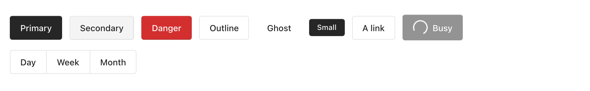
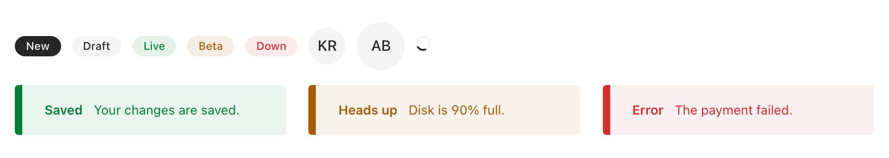
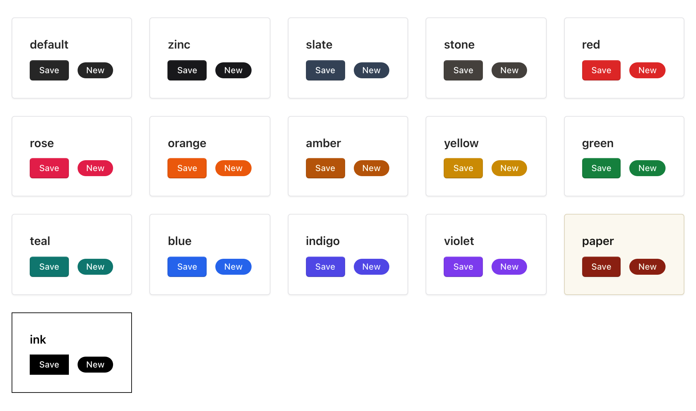

# fhoat


<!-- WARNING: THIS FILE WAS AUTOGENERATED! DO NOT EDIT! -->

[Oat](https://oat.ink) is a small semantic UI library: plain tags look finished, a few classes and attributes pick variants, and a handful of
web components (tabs, dropdowns, upload, tag input) need no framework. fhoat puts Oat 1.1.0 in a FastHTML app the way `pico=True` puts
Pico there, and adds themes, light and dark modes, the reader’s own settings and FastHTML functions for each component.

## Install

``` sh
pip install fhoat
```

## Start

``` python
from fhoat import *        # everything in fasthtml.common, plus fhoat

app, rt = fast_app(oat=True)

@rt
def index():
    return (Navbar('My app', ('Docs', '/docs'), end=(ThemePicker(), ModeToggle())),
            Container(Grid(Card(P('Plain tags are styled.'), header=H3('One')),
                           Card(P('Classes pick variants.'), header=H3('Two'), footer=Btn('Go')))))

serve()
```

`oat` takes `True`, a preset name (`'blue'`), a dict (`dict(primary='#8a1f11', radius='lg')`) or a [`Theme`](https://vedicreader.github.io/fhoat/core.html#theme). `oat=False` gives plain
FastHTML with Pico. The files come from your own app at `/fhoat/`, hashed and cached for a year; nothing loads from a CDN unless you pass
`oat_kw=dict(cdn=True)`.

## What styles itself

`Button`, `A`, `Input`, `Select`, `Textarea`, `Label`, `Fieldset`, `Table`, `Dialog`, `Details`, `Progress`, `Meter` and the headings
need nothing. `A(..., cls='button')` is a link drawn as a button. A `Div` has no look of its own: give it `cls='card'`, `'row'`,
`'hstack'`, `'vstack'` or `'container'`, or use the functions below. With the restyle on (the default), fhoat also sets the type,
links, code, tables and focus rings.

## Examples

A form that posts with htmx, shows a server error on the field and a toast on success:

``` python
@rt
def signup(): return Form(Field('Email', Input(name='email', type='email'), hint='We never share it.'), Btn('Join'), hx_post=join, hx_swap='outerHTML')

@rt
def join(email: str):
    if '@' not in email: return Form(Field('Email', Input(name='email', value=email), error='That is not an email.', invalid=True), Btn('Join'), hx_post=join, hx_swap='outerHTML')
    return P('Thanks.'), toast_hdr('You are in.', 'Welcome', 'success')
```

A dialog that opens from a button and closes itself:

``` python
DialogOpen('Delete', id='del'), DialogX(P('This cannot be undone.'), header=H3('Delete project?'),
                                        footer=(DialogClose('Cancel'), Btn('Delete', variant='danger', hx_delete='/p/1')), id='del')
```

Tabs, a menu, a spinner while htmx works:

``` python
Tabs(('Account', P('…')), ('Billing', P('…')), anchor='tab')
Dropdown('Options', A('Profile', href='/me'), Hr(), Btn('Sign out', hx_post='/out'))
OatBusy()   # in the page: every htmx request marks its element aria-busy, which Oat draws as a spinner
```

An app shell with a sidebar:

``` python
Sidebar(Ul(Li(A('Home', href='/', aria_current='page')), Li(A('Users', href='/u'))), Container(H1('Home')), topnav=(SidebarToggle(), Strong('My app')))
```

## Themes and the reader’s settings

Presets: `default zinc slate stone red rose orange amber yellow green teal blue indigo violet paper ink`; `paper` and `ink` also change
the surfaces. Each works in light and in dark.

``` python
fast_app(oat=Theme(name='paper', primary=('#8a1f11', '#dcae6d'), radius='md', shadow='sm', size='lg', font='serif', tokens=dict(container_max='64rem')))
```

`radius`, `shadow` and `size` are the app’s defaults: the reader changes them with [`ThemePicker`](https://vedicreader.github.io/fhoat/components.html#themepicker) and [`FontToggle`](https://vedicreader.github.io/fhoat/components.html#fonttoggle), and [`ModeToggle`](https://vedicreader.github.io/fhoat/components.html#modetoggle) moves
between auto, light and dark. The browser keeps the choice in `localStorage` and applies it before first paint. From your own script:
`fhoat.set('radius', 'lg')`, `fhoat.mode('dark')`, `fhoat.theme('teal')`, `fhoat.cycle('size', ['', 'lg', 'xl'])`. A change fires a
`fhoat` event on `<html>`, which carries `data-mode data-theme data-radius data-shadow data-size` and the class `dark` or `light`.

Your own CSS wins without `!important`: fhoat’s rules sit in Oat’s layers, and the theme’s tokens in one unlayered `:root` rule.

## Layers

`oat_kw` (or [`oat_hdrs`](https://vedicreader.github.io/fhoat/core.html#oat_hdrs) directly) picks the layers:

| flag | default | adds |
|----|----|----|
| `presets` | on | mode, presets, the reader’s settings (`themes.css`) |
| `components` | on | what fhoat’s components need: card parts, grid, navbar, hero, footer, controls (`components.css`) |
| `restyle` | on | type, links, code, tables, focus (`fhoat.css`) |
| `script` | on | mode, settings, controls and toasts (`fhoat.js`, inline) |
| `compat` | off | Oat 1.0’s tokens, metrics and title sweep, for an app drawn on 1.0 |
| `cdn` | off | Oat from jsDelivr, with SRI |
| `prefix` | `/fhoat` | where the files are served |

[`fast_app`](https://vedicreader.github.io/fhoat/core.html#fast_app) also takes `mode`, `tips=False` (hide Oat’s tooltips for an app that draws its own) and `store` (the `localStorage` key).

## An existing app

[`setup_oat`](https://vedicreader.github.io/fhoat/core.html#setup_oat) does what `fast_app(oat=...)` does, on an app you already have, including one built with `FastHTML(...)`:

``` python
app = FastHTML()
setup_oat(app, 'teal', restyle=False)
setup_oat_toasts(app)   # FastHTML's add_toast(sess, msg, typ) now shows Oat toasts
```

An app that serves its own files mounts `OAT_DIR` and passes its path as `prefix`; an app that builds its own head calls [`oat_hdrs`](https://vedicreader.github.io/fhoat/core.html#oat_hdrs) and
[`oat_htmlkw`](https://vedicreader.github.io/fhoat/core.html#oat_htmlkw):

``` python
app.router.routes.insert(0, Mount('/css/fhoat', StaticImmutable(directory=OAT_DIR)))
hdrs = oat_hdrs(restyle=False, presets=False, script=False, compat=True, prefix='/css/fhoat')
```

``` python
app, rt = fast_app(oat='blue')
assert app.htmlkw['data_theme'] == 'blue'
```

## Components

|                 |                                                    |
|-----------------|----------------------------------------------------|
| Pico’s names    | `Card Group Search Grid DialogX Container OatBusy` |
| Layout          | `Row Column Sidebar SidebarToggle`                 |
| Buttons         | `Btn ABtn ButtonGroup DialogOpen DialogClose tip`  |
| Content         | `Badge Alert Avatar AvatarGroup Skeleton Spinner`  |
| Forms           | `Field Switch Upload TagInput`                     |
| Interactive     | `Tabs Dropdown`                                    |
| Page            | `Navbar Hero PageFooter`                           |
| Reader controls | `ModeToggle ThemePicker FontToggle`                |
| Toasts          | `OatToast toast_hdr setup_oat_toasts`              |

[`Search`](https://vedicreader.github.io/fhoat/components.html#search) hides FastHTML’s `<search>` tag, as in `fasthtml.pico`. FastHTML’s `Col` (the `<col>` tag) and `Toast` stay as they are; fhoat’s
are [`Column`](https://vedicreader.github.io/fhoat/components.html#column) and [`OatToast`](https://vedicreader.github.io/fhoat/components.html#oattoast).

The demo shows each one: `python -m fhoat.demo`, then open http://localhost:5002.

### A tour

Each group below is built in one cell and shown by `preview`, which serves it at `/name` on a small Oat app and frames that page. In Jupyter the frame is live once `JupyUvi` serves the app; on GitHub, PyPI and the docs site, the picture under each cell shows the same components.

``` python
PORT, SHOWN = 8005, {}
pv, _ = fast_app(oat=True, title='fhoat')

def preview(name, *c, height=160):
    "Serve `c` at `/name` on the preview app and frame it."
    SHOWN[name] = c
    pv.get(f'/{name}')(lambda: Main(*c, cls='container', style='padding:1.5rem 1rem'))
    return HTMX(f'/{name}', port=PORT, height=height)
```

``` python
srv = JupyUvi(pv, port=PORT)
```

[`Navbar`](https://vedicreader.github.io/fhoat/components.html#navbar) and [`Hero`](https://vedicreader.github.io/fhoat/components.html#hero) start a page. The [`ThemePicker`](https://vedicreader.github.io/fhoat/components.html#themepicker) and [`ModeToggle`](https://vedicreader.github.io/fhoat/components.html#modetoggle) at the end of the bar are the reader’s own controls.

``` python
preview('page',
        Navbar('My app', ('Docs', '#'), ('Blog', '#'), end=(ThemePicker(), ModeToggle())),
        Hero('Semantic HTML that looks finished', sub='One switch puts Oat in a FastHTML app: fast_app(oat=True).', eyebrow='fhoat',
             actions=(ABtn('Start', href='#'), ABtn('GitHub', href='#', look='outline'))), height=440)
```


[`Btn`](https://vedicreader.github.io/fhoat/components.html#btn) takes a `variant` for meaning, a `look` for weight and a `size`; [`ABtn`](https://vedicreader.github.io/fhoat/components.html#abtn) is a link drawn the same way, and [`ButtonGroup`](https://vedicreader.github.io/fhoat/components.html#buttongroup) joins buttons into one control.

``` python
preview('buttons',
        Div(Btn('Primary'), Btn('Secondary', variant='secondary'), Btn('Danger', variant='danger'), Btn('Outline', look='outline'),
            Btn('Ghost', look='ghost'), Btn('Small', size='small'), ABtn('A link', href='#', look='outline'), Btn('Busy', aria_busy='true', disabled=True), cls='hstack mb-4'),
        ButtonGroup(Btn('Day', look='outline'), Btn('Week', look='outline'), Btn('Month', look='outline')))
```



[`Badge`](https://vedicreader.github.io/fhoat/components.html#badge) and [`Alert`](https://vedicreader.github.io/fhoat/components.html#alert) take the same `variant` names as [`Btn`](https://vedicreader.github.io/fhoat/components.html#btn). [`Avatar`](https://vedicreader.github.io/fhoat/components.html#avatar) draws initials or a picture, and [`Spinner`](https://vedicreader.github.io/fhoat/components.html#spinner) marks work in progress.

``` python
preview('content',
        Div(Badge('New'), Badge('Draft', variant='secondary'), Badge('Live', variant='success'), Badge('Beta', variant='warning'),
            Badge('Down', variant='danger'), Avatar(initials='KR'), Avatar(initials='AB', size='large'), Spinner(size='sm'), cls='hstack mb-4'),
        Grid(Alert('Your changes are saved.', title='Saved', variant='success'), Alert('Disk is 90% full.', title='Heads up', variant='warning'),
             Alert('The payment failed.', title='Error', variant='danger')), height=260)
```



[`Field`](https://vedicreader.github.io/fhoat/components.html#field) links a label, a hint and an error to its input. With `invalid=True` the field shows its error, for the eye and for a screen reader. Range, progress and search groups are plain HTML that Oat styles.

``` python
signup = Card(Form(Field('Email', Input(type='email', name='email', placeholder='you@example.com'), hint='We never share it.'),
                   Field('Plan', Select(Option('Free'), Option('Pro'), name='plan')),
                   Div(Switch('Email me updates', name='news', checked=True), Label(Input(type='checkbox', name='tos'), 'I agree'), cls='hstack')),
              header=H3('Sign up'), footer=Btn('Join'))
checks = Card(Field('Email', Input(name='bad', value='name@'), error='That is not an email.', invalid=True),
              Group(Input(type='search', name='q', placeholder='Search'), Btn('Go')), Input(type='range'), Progress(value=60, max=100),
              header=H3('Errors and native inputs'))
preview('forms', Grid(signup, checks), height=480)
```


[`Tabs`](https://vedicreader.github.io/fhoat/components.html#tabs) takes (label, content) pairs. A plain `Table` inside `Div(cls='table')` scrolls sideways on a narrow screen.

``` python
rows = [('Rigveda', '10,552', 'success', 'Live'), ('Tirukkuṟaḷ', '1,330', 'warning', 'Review'), ('Arthaśāstra', '5,348', 'secondary', 'Draft')]
works = Div(Table(Thead(Tr(Th('Work'), Th('Verses'), Th('State'))),
                  Tbody(*[Tr(Td(Strong(w)), Td(n), Td(Badge(b, variant=v))) for w, n, v, b in rows])), cls='table')
preview('tabs', Tabs(('Works', works), ('Billing', P('Invoices and cards.')), ('Team', P('Invite people.'))), height=300)
```


Each preset is a `data-theme` value and works on any element, so one page can set the presets side by side. Oat’s colours are `light-dark()` pairs, so a wrapper with `color-scheme: dark` shows the same cards in dark mode.

``` python
swatch = lambda t: Card(Strong(t), Div(Btn('Save', size='small'), Badge('New'), cls='hstack mt-2'), data_theme=t)
swatches = Grid(*map(swatch, THEMES), col_min='9rem')
preview('themes', swatches, height=520)
```



``` python
preview('themes_dark', Div(swatches, style='color-scheme:dark; background:var(--background); color:var(--foreground); padding:1rem'), height=560)
```


## Develop

fhoat is an [nbdev](https://nbdev.fast.ai) project: the code and its tests are in `nbs/`.

``` sh
pip install -e '.[dev]'
nbdev-export      # nbs/ to fhoat/
nbdev-test        # run the notebooks
nbdev-prepare     # both, plus clean
```

The tour’s pictures come from the tour’s own cells. After a change to a component, retake them and regenerate this README:

``` sh
uv run --no-project --with-editable . --with execnb --with playwright python tools/shots.py   # or name the groups: ... tools/shots.py buttons forms
nbdev-readme
```

Oat 1.1.0 is © Kailash Nadh, MIT (`fhoat/static/LICENSE-oat`). The icons are from Lucide (ISC).
