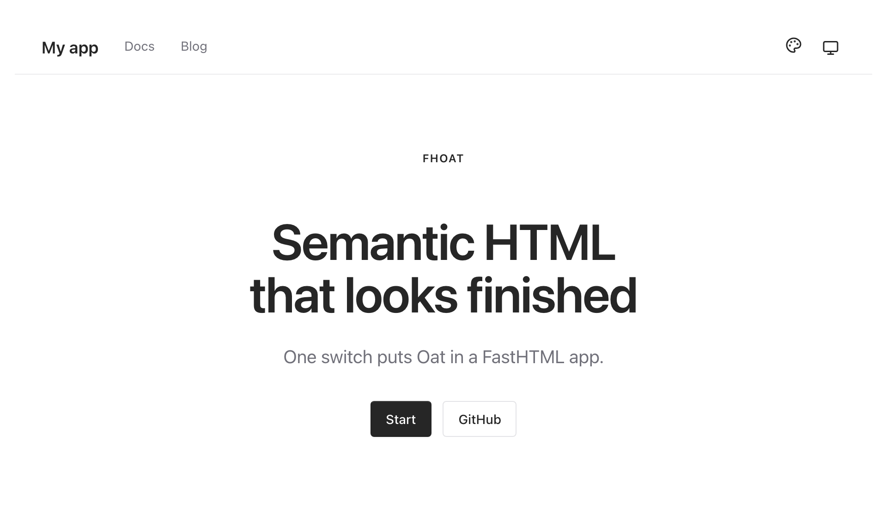
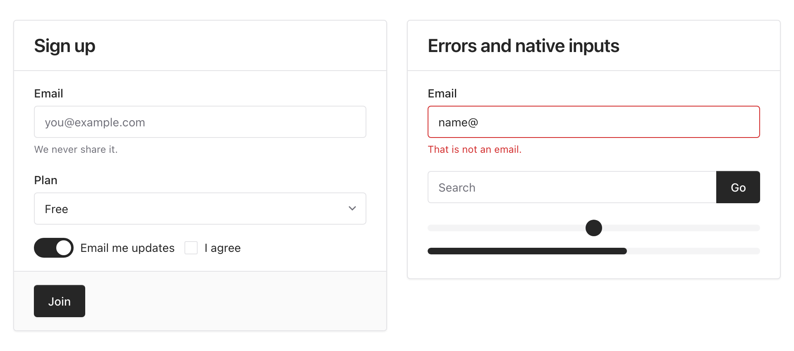
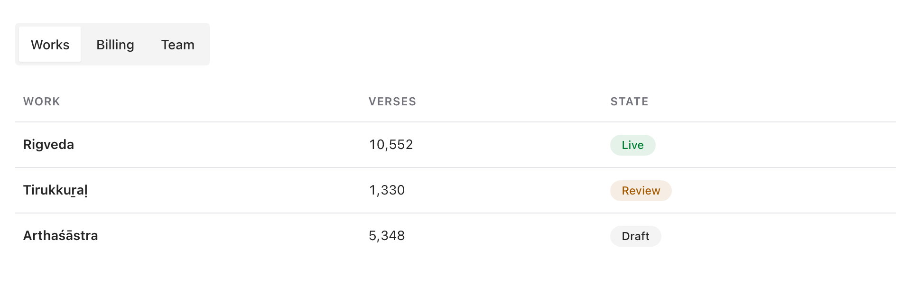
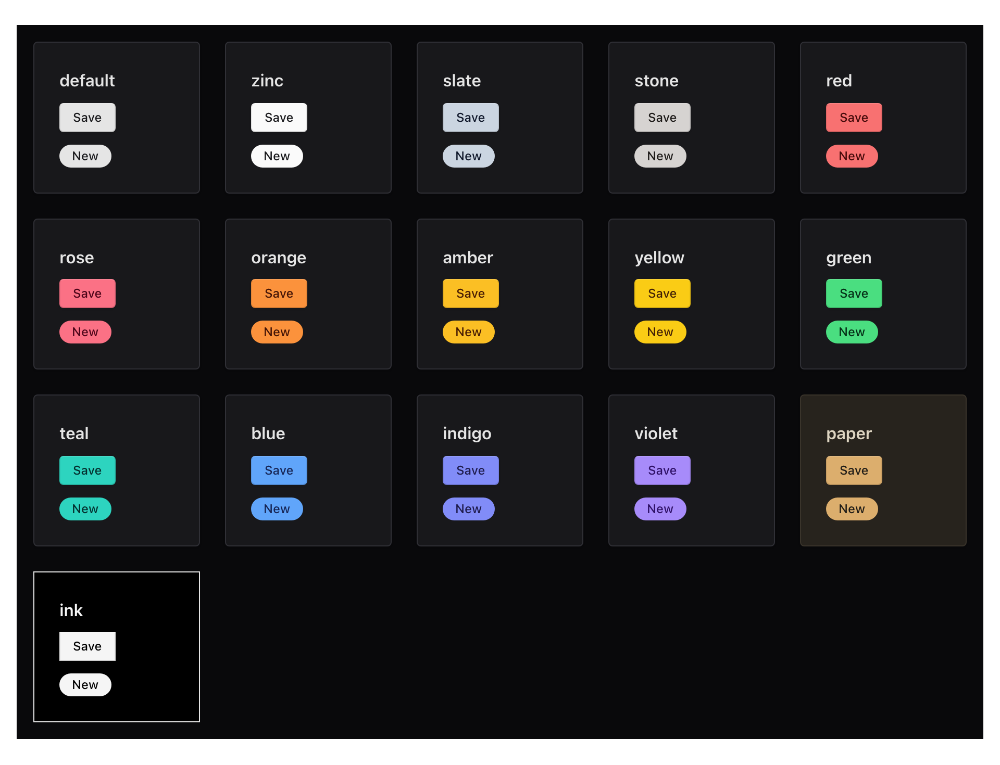

# fhoat


<!-- WARNING: THIS FILE WAS AUTOGENERATED! DO NOT EDIT! -->

fhoat styles a FastHTML app with [Oat](https://oat.ink) instead of Pico. Install it and pass `oat=True` to [`fast_app`](https://vedicreader.github.io/fhoat/core.html#fast_app).

``` sh
pip install fhoat
```

``` python
from fhoat import *

app, rt = fast_app(oat=True)

@rt
def index(): return Container(Card(P('Plain tags are styled.'), header=H3('Hello'), footer=Btn('Go')))

serve()
```

`from fhoat import *` imports everything in `fasthtml.common` and the fhoat components.

## Examples

### A page

``` python
nav = Navbar('My app', ('Docs', '#'), ('Blog', '#'), end=(ThemePicker(), ModeToggle()))
hero = Hero('Semantic HTML that looks finished', eyebrow='fhoat',
            sub='One switch puts Oat in a FastHTML app.',
            actions=(ABtn('Start', href='#'), ABtn('GitHub', href='#', look='outline')))
```



### Buttons

``` python
buttons = Div(Btn('Primary'), Btn('Secondary', variant='secondary'), Btn('Danger', variant='danger'),
              Btn('Outline', look='outline'), Btn('Ghost', look='ghost'), Btn('Small', size='small'),
              ABtn('A link', href='#', look='outline'), Btn('Busy', aria_busy='true', disabled=True),
              cls='hstack mb-4')
group = ButtonGroup(*[Btn(o, look='outline') for o in ('Day', 'Week', 'Month')])
```


### Badges, avatars and alerts

``` python
badges = Div(Badge('New'), Badge('Draft', variant='secondary'), Badge('Live', variant='success'),
             Badge('Beta', variant='warning'), Badge('Down', variant='danger'),
             Avatar(initials='KR'), Avatar(initials='AB', size='large'), Spinner(size='sm'),
             cls='hstack mb-4')
alerts = Grid(Alert('Your changes are saved.', title='Saved', variant='success'),
              Alert('Disk is 90% full.', title='Heads up', variant='warning'),
              Alert('The payment failed.', title='Error', variant='danger'))
```


### Forms

``` python
signup = Card(Form(Field('Email', Input(type='email', name='email', placeholder='you@example.com'),
                         hint='We never share it.'),
                   Field('Plan', Select(Option('Free'), Option('Pro'), name='plan')),
                   Div(Switch('Email me updates', name='news', checked=True),
                       Label(Input(type='checkbox', name='tos'), 'I agree'), cls='hstack')),
              header=H3('Sign up'), footer=Btn('Join'))
checks = Card(Field('Email', Input(name='bad', value='name@'), error='That is not an email.', invalid=True),
              Group(Input(type='search', name='q', placeholder='Search'), Btn('Go')),
              Input(type='range'), Progress(value=60, max=100),
              header=H3('Errors and native inputs'))
```



### Tabs and tables

``` python
rows = [('Rigveda', '10,552', 'success', 'Live'), ('Tirukkuṟaḷ', '1,330', 'warning', 'Review'),
        ('Arthaśāstra', '5,348', 'secondary', 'Draft')]
works = Div(Table(Thead(Tr(Th('Work'), Th('Verses'), Th('State'))),
                  Tbody(*[Tr(Td(Strong(w)), Td(n), Td(Badge(b, variant=v))) for w, n, v, b in rows])),
            cls='table')
tabs = Tabs(('Works', works), ('Billing', P('Invoices and cards.')), ('Team', P('Invite people.')))
```



### Theme presets

``` python
swatch = lambda t: Card(Strong(t), Div(Btn('Save', size='small'), Badge('New'), cls='hstack mt-2'), data_theme=t)
swatches = Grid(*map(swatch, THEMES), col_min='9rem')
```


### Theme presets in dark mode

``` python
dark = Div(swatches, style='color-scheme:dark; background:var(--background); color:var(--foreground); padding:1rem')
```



### With htmx

A sign-up form. The server returns the form with an error, or a toast:

``` python
def signup_form(email='', error=None):
    return Form(Field('Email', Input(name='email', type='email', value=email), error=error, invalid=bool(error)),
                Btn('Join'), hx_post='/join', hx_swap='outerHTML')

@rt
def join(email: str):
    if '@' not in email: return signup_form(email, 'That is not an email.')
    return P('Thanks.'), toast_hdr('You are in.', 'Welcome', 'success')
```

A dialog that a button opens:

``` python
DialogOpen('Delete', id='del'), DialogX(P('This cannot be undone.'), header=H3('Delete project?'),
                                        footer=(DialogClose('Cancel'), Btn('Delete', variant='danger', hx_delete='/p/1')),
                                        id='del')
```

A menu, and a spinner on each element while its htmx request runs:

``` python
Dropdown('Options', A('Profile', href='/me'), Hr(), Btn('Sign out', hx_post='/out'))
OatBusy()
```

An app shell with a sidebar:

``` python
Sidebar(Ul(Li(A('Home', href='/', aria_current='page')), Li(A('Users', href='/u'))),
        Container(H1('Home')), topnav=(SidebarToggle(), Strong('My app')))
```

## Plain tags

Oat styles `Button`, `A`, `Input`, `Select`, `Textarea`, `Label`, `Fieldset`, `Table`, `Dialog`, `Details`, `Progress`, `Meter` and the headings with no classes. `A(..., cls='button')` draws a link as a button.

A `Div` has no style. Give it `cls='card'`, `'row'`, `'hstack'`, `'vstack'` or `'container'`, or use a component function. The `restyle` layer also sets the type, links, code, tables and focus rings.

## Themes

`oat` takes `True`, a preset name, a dict or a [`Theme`](https://vedicreader.github.io/fhoat/core.html#theme). `oat=False` gives FastHTML with Pico. The preset name goes on `<html>` as `data-theme`:

``` python
app, rt = fast_app(oat='blue')
test_eq(app.htmlkw['data_theme'], 'blue')
app.htmlkw
```

The presets are `default zinc slate stone red rose orange amber yellow green teal blue indigo violet paper ink`. `paper` and `ink` also change the page surfaces. Each preset has a light form and a dark form.

``` python
fast_app(oat=Theme(name='paper', primary=('#8a1f11', '#dcae6d'), radius='md', shadow='sm',
                   size='lg', font='serif', tokens=dict(container_max='64rem')))
```

`radius`, `shadow` and `size` set the defaults. The reader changes them with [`ThemePicker`](https://vedicreader.github.io/fhoat/components.html#themepicker) and [`FontToggle`](https://vedicreader.github.io/fhoat/components.html#fonttoggle). [`ModeToggle`](https://vedicreader.github.io/fhoat/components.html#modetoggle) cycles auto, light and dark. The browser keeps the reader’s choices in `localStorage` and applies them before the first paint.

Your JavaScript can make the same changes: `fhoat.set('radius', 'lg')`, `fhoat.mode('dark')`, `fhoat.theme('teal')`, `fhoat.cycle('size', ['', 'lg', 'xl'])`. Each change fires a `fhoat` event on `<html>`. The `<html>` element carries `data-mode`, `data-theme`, `data-radius`, `data-shadow`, `data-size` and the class `dark` or `light`.

Your CSS overrides fhoat without `!important`. fhoat’s rules are in Oat’s cascade layers. The theme tokens are in one unlayered `:root` rule.

## Layers

`oat_kw` goes to [`oat_hdrs`](https://vedicreader.github.io/fhoat/core.html#oat_hdrs) and selects the layers:

| flag | default | adds |
|----|----|----|
| `presets` | on | modes, presets and the reader’s settings (`themes.css`) |
| `components` | on | card parts, grid, navbar, hero, footer and controls (`components.css`) |
| `restyle` | on | type, links, code, tables and focus rings (`fhoat.css`) |
| `script` | on | modes, settings, controls and toasts (`fhoat.js`, inline) |
| `compat` | off | Oat 1.0 tokens, metrics and titles, for an app made on Oat 1.0 |
| `cdn` | off | Oat from jsDelivr, with SRI |
| `prefix` | `/fhoat` | the path of the files |

The app serves the files at `prefix`. Each file URL carries a content hash, and the browser caches the file for a year. Nothing loads from a CDN unless you pass `oat_kw=dict(cdn=True)`.

[`fast_app`](https://vedicreader.github.io/fhoat/core.html#fast_app) also takes `mode`, `tips` and `store`. `tips=False` turns off Oat’s tooltips. `store` names the `localStorage` key.

## An existing app

[`setup_oat`](https://vedicreader.github.io/fhoat/core.html#setup_oat) adds Oat to an app you already have, including an app made with `FastHTML(...)`. [`setup_oat_toasts`](https://vedicreader.github.io/fhoat/components.html#setup_oat_toasts) makes FastHTML’s `add_toast(sess, msg, typ)` show Oat toasts.

``` python
app = FastHTML()
setup_oat(app, 'teal', restyle=False)
setup_oat_toasts(app)
```

To serve the files yourself, mount `OAT_DIR` and pass its path as `prefix`. To make the head yourself, call [`oat_hdrs`](https://vedicreader.github.io/fhoat/core.html#oat_hdrs) and [`oat_htmlkw`](https://vedicreader.github.io/fhoat/core.html#oat_htmlkw).

``` python
app.router.routes.insert(0, Mount('/css/fhoat', StaticImmutable(directory=OAT_DIR)))
hdrs = oat_hdrs(restyle=False, presets=False, script=False, compat=True, prefix='/css/fhoat')
```

## Components

|                 |                                                    |
|-----------------|----------------------------------------------------|
| Pico’s names    | `Card Group Search Grid DialogX Container OatBusy` |
| Layout          | `Row Column Sidebar SidebarToggle`                 |
| Buttons         | `Btn ABtn ButtonGroup DialogOpen DialogClose tip`  |
| Content         | `Badge Alert Avatar AvatarGroup Skeleton Spinner`  |
| Forms           | `Field Switch Upload TagInput`                     |
| Interactive     | `Tabs Dropdown`                                    |
| Page            | `Navbar Hero PageFooter`                           |
| Reader controls | `ModeToggle ThemePicker FontToggle`                |
| Toasts          | `OatToast toast_hdr setup_oat_toasts`              |

[`Search`](https://vedicreader.github.io/fhoat/components.html#search) replaces FastHTML’s `<search>` tag, as `fasthtml.pico` does. FastHTML’s `Col` and `Toast` are unchanged. fhoat’s versions are [`Column`](https://vedicreader.github.io/fhoat/components.html#column) and [`OatToast`](https://vedicreader.github.io/fhoat/components.html#oattoast).

`python -m fhoat.demo` serves every component at http://localhost:5002.

## Develop

fhoat is an [nbdev](https://nbdev.fast.ai) project. The code and the tests are in `nbs/`.

``` sh
pip install -e '.[dev]'
nbdev-export      # nbs/ to fhoat/
nbdev-test        # run the notebooks
nbdev-prepare     # export, test, clean and readme
```

Open `nbs/index.ipynb` in Jupyter to see each example live. `tools/shots.py` runs the same cells and saves the pictures in `nbs/images/`. After you change a component, run it, then run `nbdev-readme`:

``` sh
uv run --no-project --with-editable . --with execnb --with playwright python tools/shots.py
nbdev-readme
```

Oat 1.1.0 is © Kailash Nadh, MIT (`fhoat/static/LICENSE-oat`). The icons are from Lucide (ISC).
