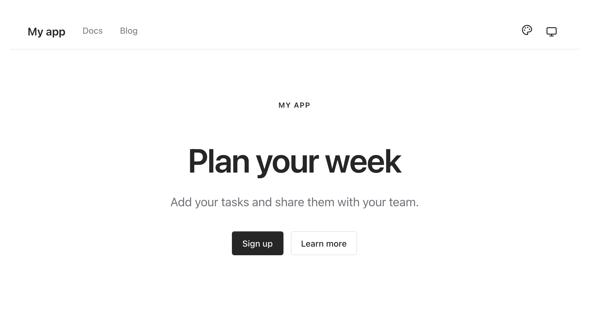
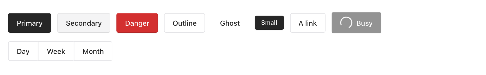
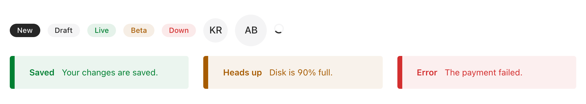
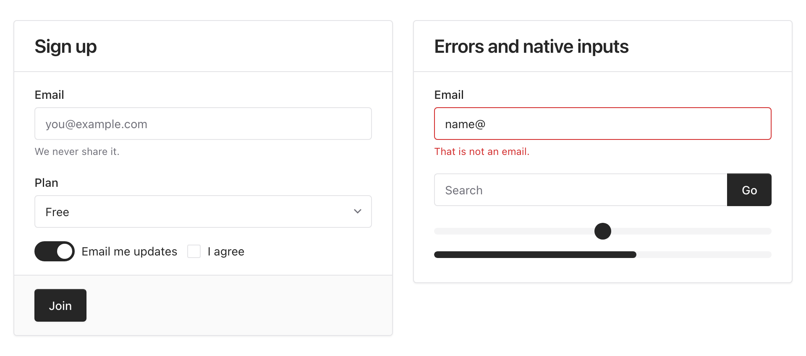
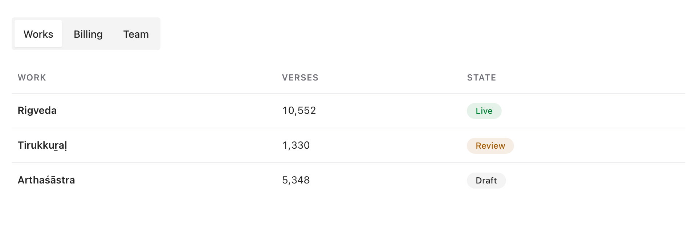
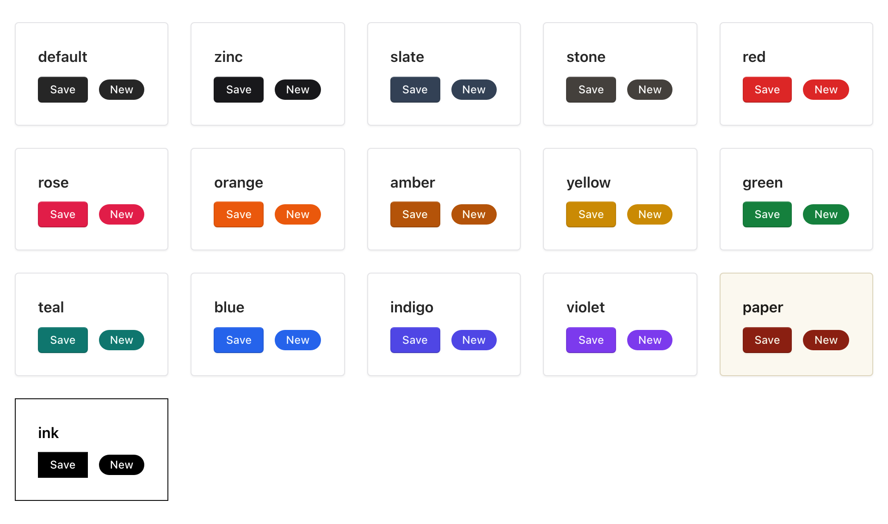
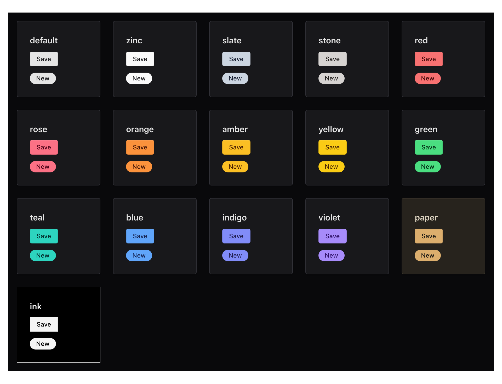

# fhoat


<!-- WARNING: THIS FILE WAS AUTOGENERATED! DO NOT EDIT! -->

fhoat adds the [Oat](https://oat.ink) CSS library to a FastHTML app. It
replaces Pico, which FastHTML uses by default. Install fhoat, then pass
`oat=True` to
[`fast_app`](https://vedicreader.github.io/fhoat/core.html#fast_app).

``` sh
pip install fhoat
```

``` python
from fhoat import *

app, rt = fast_app(oat=True)

@rt
def index(): return Container(Card(P('This card uses Oat styles.'), header=H3('Hello'), footer=Btn('Save')))

serve()
```

`from fhoat import *` imports everything in `fasthtml.common` and the
fhoat components.

## Examples

### A page

``` python
nav = Navbar('My app', ('Docs', '#'), ('Blog', '#'), end=(ThemePicker(), ModeToggle()))
hero = Hero('Plan your week', eyebrow='My app',
            sub='Add your tasks and share them with your team.',
            actions=(ABtn('Sign up', href='#'), ABtn('Learn more', href='#', look='outline')))
```

<figure>

<figcaption aria-hidden="true">A navbar and a hero</figcaption>
</figure>

### Buttons

``` python
buttons = Div(Btn('Primary'), Btn('Secondary', variant='secondary'), Btn('Danger', variant='danger'),
              Btn('Outline', look='outline'), Btn('Ghost', look='ghost'), Btn('Small', size='small'),
              ABtn('A link', href='#', look='outline'), Btn('Busy', aria_busy='true', disabled=True),
              cls='hstack mb-4')
group = ButtonGroup(*[Btn(o, look='outline') for o in ('Day', 'Week', 'Month')])
```

<figure>

<figcaption aria-hidden="true">Buttons</figcaption>
</figure>

### Badges, avatars and alerts

``` python
badges = Div(Badge('New'), Badge('Draft', variant='secondary'), Badge('Live', variant='success'),
             Badge('Beta', variant='warning'), Badge('Down', variant='danger'),
             Avatar(initials='KR'), Avatar(initials='AB', size='large'), Spinner(size='sm'),
             cls='hstack mb-4')
alerts = Grid(Alert('Your changes are saved.', title='Saved', variant='success'),
              Alert('The disk is 90% full.', title='Warning', variant='warning'),
              Alert('The payment failed.', title='Error', variant='danger'))
```

<figure>

<figcaption aria-hidden="true">Badges, avatars and alerts</figcaption>
</figure>

### Forms

``` python
signup = Card(Form(Field('Email', Input(type='email', name='email', placeholder='you@example.com'),
                         hint='We never share it.'),
                   Field('Plan', Select(Option('Free'), Option('Pro'), name='plan')),
                   Div(Switch('Email me updates', name='news', checked=True),
                       Label(Input(type='checkbox', name='tos'), 'I agree'), cls='hstack')),
              header=H3('Sign up'), footer=Btn('Join'))
checks = Card(Field('Email', Input(name='bad', value='name@'), error='Enter a valid email address.', invalid=True),
              Group(Input(type='search', name='q', placeholder='Search'), Btn('Go')),
              Input(type='range'), Progress(value=60, max=100),
              header=H3('Errors and HTML inputs'))
```

<figure>

<figcaption aria-hidden="true">Forms</figcaption>
</figure>

### Tabs and tables

``` python
rows = [('Rigveda', '10,552', 'success', 'Live'), ('Tirukkuṟaḷ', '1,330', 'warning', 'Review'),
        ('Arthaśāstra', '5,348', 'secondary', 'Draft')]
works = Div(Table(Thead(Tr(Th('Work'), Th('Verses'), Th('State'))),
                  Tbody(*[Tr(Td(Strong(w)), Td(n), Td(Badge(b, variant=v))) for w, n, v, b in rows])),
            cls='table')
tabs = Tabs(('Works', works), ('Billing', P('Your invoices and payment cards.')), ('Team', P('Add people to your team.')))
```

<figure>

<figcaption aria-hidden="true">Tabs holding a table</figcaption>
</figure>

### Theme presets

``` python
swatch = lambda t: Card(Strong(t), Div(Btn('Save', size='small'), Badge('New'), cls='hstack mt-2'), data_theme=t)
swatches = Grid(*map(swatch, THEMES), col_min='9rem')
```

<figure>

<figcaption aria-hidden="true">The presets in light mode</figcaption>
</figure>

### Theme presets in dark mode

``` python
dark = Div(swatches, style='color-scheme:dark; background:var(--background); color:var(--foreground); padding:1rem')
```

<figure>

<figcaption aria-hidden="true">The presets in dark mode</figcaption>
</figure>

### With htmx

This sign-up form sends the email to `/join`. If the email is not valid,
the server sends back the form with an error. Otherwise, the server
sends a toast.

``` python
def signup_form(email='', error=None):
    return Form(Field('Email', Input(name='email', type='email', value=email), error=error, invalid=bool(error)),
                Btn('Join'), hx_post='/join', hx_swap='outerHTML')

@rt
def join(email: str):
    if '@' not in email: return signup_form(email, 'Enter a valid email address.')
    return P('Thank you.'), toast_hdr('You signed up.', 'Welcome', 'success')
```

The button opens the dialog that has the same `id`.

``` python
DialogOpen('Delete', id='del'), DialogX(P('This cannot be undone.'), header=H3('Delete project?'),
                                        footer=(DialogClose('Cancel'), Btn('Delete', variant='danger', hx_delete='/p/1')),
                                        id='del')
```

[`Dropdown`](https://vedicreader.github.io/fhoat/components.html#dropdown)
makes a menu.
[`OatBusy`](https://vedicreader.github.io/fhoat/components.html#oatbusy)
shows a spinner on an element while its htmx request runs.

``` python
Dropdown('Options', A('Profile', href='/me'), Hr(), Btn('Sign out', hx_post='/out'))
OatBusy()
```

[`Sidebar`](https://vedicreader.github.io/fhoat/components.html#sidebar)
makes a page with a side menu.
[`SidebarToggle`](https://vedicreader.github.io/fhoat/components.html#sidebartoggle)
opens and closes the menu on small screens.

``` python
Sidebar(Ul(Li(A('Home', href='/', aria_current='page')), Li(A('Users', href='/u'))),
        Container(H1('Home')), topnav=(SidebarToggle(), Strong('My app')))
```

## Plain tags

Oat styles `Button`, `A`, `Input`, `Select`, `Textarea`, `Label`,
`Fieldset`, `Table`, `Dialog`, `Details`, `Progress`, `Meter` and the
headings with no classes. `A(..., cls='button')` draws a link as a
button.

A `Div` has no style. Give it `cls='card'`, `'row'`, `'hstack'`,
`'vstack'` or `'container'`, or use a component function. The `restyle`
layer also styles text, links, code, tables and focus rings.

## Themes

The `oat` argument takes `True`, a preset name, a dict or a
[`Theme`](https://vedicreader.github.io/fhoat/core.html#theme). With
`oat=False`, FastHTML uses Pico. fhoat puts the preset name on the
`<html>` element as the `data-theme` attribute.

``` python
app, rt = fast_app(oat='blue')
test_eq(app.htmlkw['data_theme'], 'blue')
app.htmlkw
```

The presets are
`default zinc slate stone red rose orange amber yellow green teal blue indigo violet paper ink`.
`paper` and `ink` also change the page surfaces. Each preset has a light
form and a dark form.

``` python
fast_app(oat=Theme(name='paper', primary=('#8a1f11', '#dcae6d'), radius='md', shadow='sm',
                   size='lg', font='serif', tokens=dict(container_max='64rem')))
```

`radius`, `shadow` and `size` set the default values. The user can
change them with
[`ThemePicker`](https://vedicreader.github.io/fhoat/components.html#themepicker)
and
[`FontToggle`](https://vedicreader.github.io/fhoat/components.html#fonttoggle).
[`ModeToggle`](https://vedicreader.github.io/fhoat/components.html#modetoggle)
changes the mode from auto to light to dark. The browser keeps the
user’s choices in `localStorage`. It applies them before it shows the
page.

Your JavaScript can make the same changes. For example,
`fhoat.set('radius', 'lg')` sets a large radius, and
`fhoat.mode('dark')` sets dark mode. `fhoat.theme('teal')` sets a
preset. `fhoat.cycle('size', ['', 'lg', 'xl'])` sets the next value in
the list. After each change, fhoat sends a `fhoat` event on `<html>`.
The `<html>` element has the attributes `data-mode`, `data-theme`,
`data-radius`, `data-shadow` and `data-size`. It also has the class
`dark` or `light`.

fhoat puts its rules in Oat’s cascade layers. It puts the theme tokens
in one `:root` rule outside the layers. Your CSS overrides fhoat without
`!important`.

## Layers

[`fast_app`](https://vedicreader.github.io/fhoat/core.html#fast_app)
sends `oat_kw` to
[`oat_hdrs`](https://vedicreader.github.io/fhoat/core.html#oat_hdrs).
The flags in `oat_kw` select the layers.

<table>
<colgroup>
<col style="width: 33%" />
<col style="width: 33%" />
<col style="width: 33%" />
</colgroup>
<thead>
<tr>
<th>flag</th>
<th>default</th>
<th>what it adds</th>
</tr>
</thead>
<tbody>
<tr>
<td><code>presets</code></td>
<td>on</td>
<td>modes, presets and the user’s settings
(<code>themes.css</code>)</td>
</tr>
<tr>
<td><code>components</code></td>
<td>on</td>
<td>card parts, grid, navbar, hero, footer and controls
(<code>components.css</code>)</td>
</tr>
<tr>
<td><code>restyle</code></td>
<td>on</td>
<td>text, links, code, tables and focus rings
(<code>fhoat.css</code>)</td>
</tr>
<tr>
<td><code>script</code></td>
<td>on</td>
<td>modes, settings, controls and toasts (<code>fhoat.js</code>,
inline)</td>
</tr>
<tr>
<td><code>compat</code></td>
<td>off</td>
<td>Oat 1.0 tokens, metrics and titles, for an app made on Oat 1.0</td>
</tr>
<tr>
<td><code>cdn</code></td>
<td>off</td>
<td>Oat from jsDelivr, with SRI</td>
</tr>
<tr>
<td><code>prefix</code></td>
<td><code>/fhoat</code></td>
<td>the path of the files</td>
</tr>
</tbody>
</table>

The app serves the files at `prefix`. Each file URL has a hash of the
file contents. The browser keeps each file in its cache for one year.
fhoat loads nothing from a CDN unless you pass `oat_kw=dict(cdn=True)`.

[`fast_app`](https://vedicreader.github.io/fhoat/core.html#fast_app)
also takes `mode`, `tips` and `store`. `mode` sets the first mode:
`'auto'`, `'light'` or `'dark'`. `tips=False` turns off Oat’s tooltips.
`store` sets the name of the `localStorage` key.

## An existing app

[`setup_oat`](https://vedicreader.github.io/fhoat/core.html#setup_oat)
adds Oat to an app that you already have. This includes an app that you
made with `FastHTML(...)`. After you call
[`setup_oat_toasts`](https://vedicreader.github.io/fhoat/components.html#setup_oat_toasts),
FastHTML’s `add_toast(sess, msg, typ)` shows Oat toasts.

``` python
app = FastHTML()
setup_oat(app, 'teal', restyle=False)
setup_oat_toasts(app)
```

To serve the files from a different path, mount `OAT_DIR` at that path
and pass the path as `prefix`. To make the page head yourself, call
[`oat_hdrs`](https://vedicreader.github.io/fhoat/core.html#oat_hdrs) and
[`oat_htmlkw`](https://vedicreader.github.io/fhoat/core.html#oat_htmlkw).

``` python
app.router.routes.insert(0, Mount('/css/fhoat', StaticImmutable(directory=OAT_DIR)))
hdrs = oat_hdrs(restyle=False, presets=False, script=False, compat=True, prefix='/css/fhoat')
```

## Components

<table>
<colgroup>
<col style="width: 50%" />
<col style="width: 50%" />
</colgroup>
<tbody>
<tr>
<td>Same names as Pico</td>
<td><code>Card Group Search Grid DialogX Container OatBusy</code></td>
</tr>
<tr>
<td>Layout</td>
<td><code>Row Column Sidebar SidebarToggle</code></td>
</tr>
<tr>
<td>Buttons</td>
<td><code>Btn ABtn ButtonGroup DialogOpen DialogClose tip</code></td>
</tr>
<tr>
<td>Content</td>
<td><code>Badge Alert Avatar AvatarGroup Skeleton Spinner</code></td>
</tr>
<tr>
<td>Forms</td>
<td><code>Field Switch Upload TagInput</code></td>
</tr>
<tr>
<td>Interactive</td>
<td><code>Tabs Dropdown</code></td>
</tr>
<tr>
<td>Page</td>
<td><code>Navbar Hero PageFooter</code></td>
</tr>
<tr>
<td>User controls</td>
<td><code>ModeToggle ThemePicker FontToggle</code></td>
</tr>
<tr>
<td>Toasts</td>
<td><code>OatToast toast_hdr setup_oat_toasts</code></td>
</tr>
</tbody>
</table>

[`Search`](https://vedicreader.github.io/fhoat/components.html#search)
replaces FastHTML’s `<search>` tag, as it does in `fasthtml.pico`. fhoat
does not change FastHTML’s `Col` and `Toast`. The fhoat versions are
[`Column`](https://vedicreader.github.io/fhoat/components.html#column)
and
[`OatToast`](https://vedicreader.github.io/fhoat/components.html#oattoast).

`python -m fhoat.demo` serves every component at http://localhost:5002.

## Develop

fhoat is an [nbdev](https://nbdev.fast.ai) project. The code and the
tests are in `nbs/`.

``` sh
pip install -e '.[dev]'
nbdev-export      # nbs/ to fhoat/
nbdev-test        # run the notebooks
nbdev-prepare     # export, test, clean and readme
```

Open `nbs/index.ipynb` in Jupyter to see each example in a live frame.
`tools/shots.py` runs the same cells and saves the pictures in
`nbs/images/`. After you change a component, run `tools/shots.py`, then
run `nbdev-readme`.

``` sh
uv run --no-project --with-editable . --with execnb --with playwright python tools/shots.py
nbdev-readme
```

Oat 1.1.0 is copyright Kailash Nadh. It uses the MIT license
(`fhoat/static/LICENSE-oat`). The icons come from Lucide and use the ISC
license.
